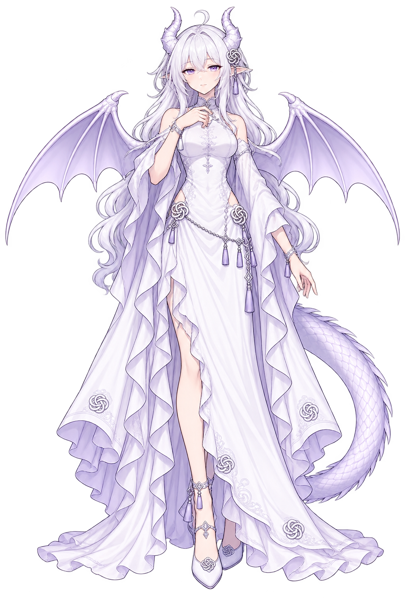

# GPT-Niang-Enhanced

GPT 娘增强版的 **macOS 公开版**。基于 [T7moris/GPT-Niang](https://github.com/T7moris/GPT-Niang) v1.3.5，增加分层动画、自然眨眼、双臂动作、本地互动和节能控制。

> **代码与文档采用 MIT；角色图片和动画图集不采用 MIT，仅在维护者有权许可的范围内随本项目进行非商业展示和分发。**
> 已包含 Q 版、龙翼长裙版两张完整立绘及三张分层动画图集。原始参考照片、用户账号、聊天记录、本机配置、备份和音效不在仓库中。第三方参考角色及商标权利仍归各自权利人；本项目不提供额外商业授权。详见 [素材使用声明](gpt-niang-usage/assets/ASSET-LICENSE.md)。

这是独立的桌面应用，不是 OpenAI、Codex 或 DeepSeek 的官方产品，也不是嵌入 Codex 聊天界面的内置宠物。

## 两种形象

| Q 版 | 龙翼长裙版 |
| --- | --- |
|  |  |

上图是完整立绘预览；实际眨眼、双手和头发等运动使用另附的分层图集。可在设置中切换全身风格，并开启或关闭「分层灵动动画」。

## 增强内容

- 原生 2D 分层运动：头部、左右手臂、眼睛、头发、尾巴，以及可选翅膀和裙摆。
- 自然眨眼、闭眼小憩、眼神与头部方向响应；双手挥动使用不同相位。
- 常驻「互动」菜单：摸头、撒娇、喂点心、逗逗她、小憩、双手挥挥、伸个懒腰。
- 拖动、有限时长的惯性和落地回弹、位置锁定、鼠标穿透、透明度与恢复显示。
- 省电 / 平衡 / 流畅档；分层动画上限分别为 15 / 24 / 30 fps，隐藏时停止视觉动画。
- 继承上游的 Codex 额度查询、语录、本地设置、窗口跟随及可选任务结束提醒。

动画逻辑不调用模型、不需要新增 API Key。额度查询通过本机 Codex CLI 使用使用者自己的登录状态；本仓库不会附带维护者的登录资料。

## 平台与边界

- 增强版面向 **macOS 13+**，Swift / SwiftUI / AppKit，Node.js 20+。
- 目前本地构建验证使用 Apple Silicon；不把 Intel、多屏、系统休眠恢复或长期稳定性视为已完成验收。
- 这是关节式 2D 贴图动画，不是 Live2D 或 3D；尚未单独制作手指和肘部骨骼。
- 图集坐标与两个布局样式绑定，不是任意图片自动拆骨骼。新增素材通常需要调整 `PetRigView.swift` 的裁切与锚点。
- `gpt-niang-usage/runtime` 保留部分上游 Windows 辅助源码及回归测试，但本仓库不提供完整 Windows 安装包，也不声称新增动画已经移植到 Windows。
- 增强版关闭上游自动更新，避免用上游原版覆盖新增功能。

## 构建

需要已安装 Xcode 或相容的 Command Line Tools、Swift 5.9+ 和 Node.js 20+。

```sh
git clone https://github.com/Zqg24105000934-svg/GPT-Niang-Enhanced.git
cd GPT-Niang-Enhanced
GPT_NIANG_BUILD_CONFIGURATION=release bash script/build_and_run.sh --build-only
```

输出位于 `dist/GPTNiangEnhanced.app`。可以在 Finder 中打开它；首次查询额度需要使用者在本机 Codex 登录。

默认构建会包含仓库中的两套角色素材。源码发布与成品安装包不同：本仓库没有发布可直接下载的应用安装包。

如果当前 Command Line Tools 的 SwiftUI 宏与 SDK 不配套，可通过 `GPT_NIANG_SDK` 指定已经安装的兼容 macOS SDK；脚本不会下载或安装 SDK。

```sh
GPT_NIANG_SDK=/path/to/MacOSX.sdk bash script/build_and_run.sh --build-only
```

生成的应用仅有本地 ad-hoc 签名，没有 Apple Developer ID 签名或公证。本仓库当前发布源码，不提供经过公证的成品安装包。

## 替换或不使用内置素材

默认从 `gpt-niang-usage/assets/` 读取内置图片。若要替换，将拥有适当授权的图片放入自己的目录，并设置 `GPT_NIANG_ASSETS` 后再构建。`local-assets/` 默认被 Git 忽略；不要把无权公开分发的角色图加入提交。

```sh
GPT_NIANG_ASSETS=/absolute/path/to/your/assets \
  bash script/build_and_run.sh --build-only
```

文件名、图集尺寸及限制见 [素材接口说明](docs/ASSETS.md)。将 `GPT_NIANG_ASSETS` 指向空目录即可构建无角色素材版；占位图标仅用于验证程序启动与基础互动，不展示分层角色动作。

## 测试

```sh
node --test gpt-niang-usage/tests/*.test.mjs
bash script/test-enhancements.sh
# 需要提供 XCTest 的完整 Xcode：
swift test --package-path macos
```

独立核心检查覆盖动作边界、双臂相位、眨眼、减少动态效果、帧率上限、指针方向及惯性边界。部分上游测试仅在 Windows 执行，在 macOS 上会跳过。

## 隐私与设置

- 用户设置保存在本机 `~/Library/Application Support/GPTNiangEnhanced/`，不写入本仓库。
- 额度功能会联系本机 Codex app-server，由 Codex 完成账号额度读取；动画和互动本身不请求模型。
- 可选的聊天速度面板和任务结束提醒会检查本机 Codex 会话记录。不要提交这些记录、截图或日志。
- 不提供云端存储、账号代理、聊天中继或公开网络监听服务。

## 来源与许可

源代码与文档沿用 [MIT License](LICENSE)，保留上游作者和贡献者版权声明。上游基线为 v1.3.5，提交 `b6f5eb8972d1802821006b7208d20a834fa6a08b`；本仓库以净化后的源码快照开始，不包含私人定制工作目录或其 Git 历史。

内置语录的来源与许可见 [quotes-LICENSE.txt](gpt-niang-usage/assets/quotes-LICENSE.txt)。角色素材遵循独立的 [素材使用声明](gpt-niang-usage/assets/ASSET-LICENSE.md)，并保留 [上游角色声明](gpt-niang-usage/assets/CHARACTER-NOTICE.txt)；不能把代码 MIT 许可理解为角色、参考图或商标的商业授权。素材来源见 [生成来源说明](gpt-niang-usage/assets/GENERATED-ASSETS.md)。

动画设计参考了 [MerZlin/dsh-pet-indesktop](https://github.com/MerZlin/dsh-pet-indesktop) 的状态分离、动作留白和资源节流思路；没有复制其角色、视频、音效或实现代码。详见 [来源说明](NOTICE.md)。
